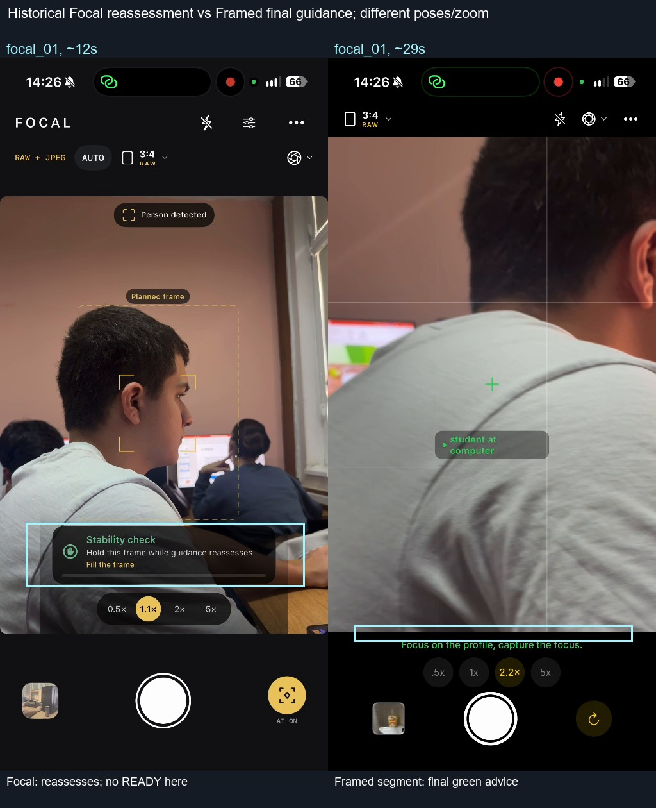
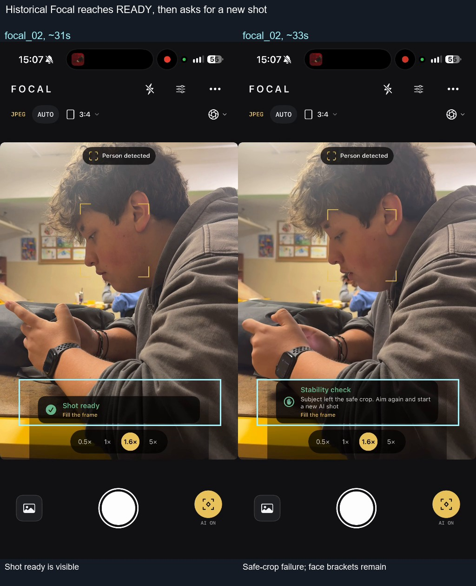
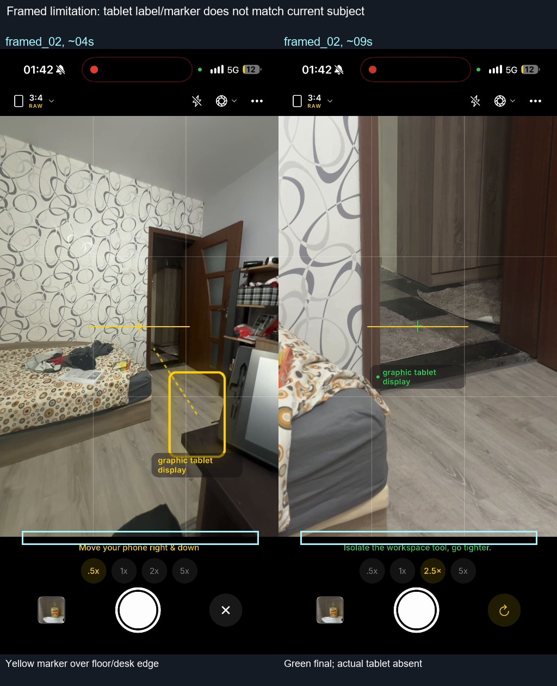
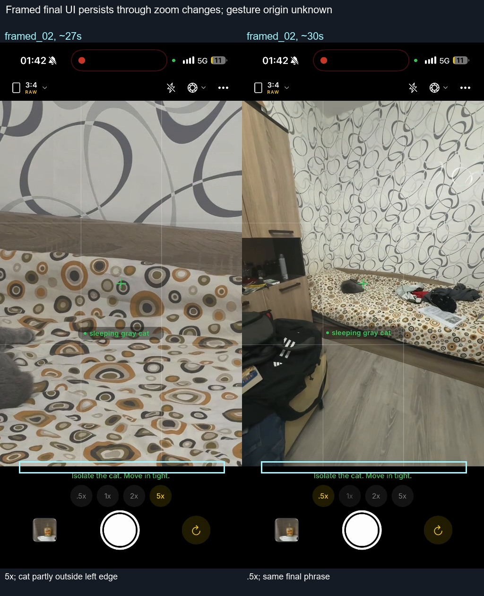

# Focal AI gap analysis

Investigation date: 2026-10-16. Source audit is pinned to upstream `61081f524fb6e10d66bfb24d0e8c30953a4a9b4f` (2.11.1). All 205 fetched files were verified against Git blob SHA-1; reconstructed Git tree exactly equals upstream `d1cd425f63a9c6dd837e3af364acc1afebad0aa3`. The local checkout has a synthetic snapshot commit because shell cloning is blocked by its proxy; remote changes must use the actual upstream commit as parent. No claim is made that the old recordings run this source.

Evidence consists of four supplied 512×1112 H.264 MP4s. No IPA, device trace, build identifiers, separate screenshots, touch overlay, outdoor footage or matched final photographs were supplied. File identities and durations are in [the manifest](evidence/framed-comparison/manifest.json). FFmpeg 8.0.1 from existing Krita installation decoded at 1 fps; overview images show every other sample. Labels are approximate output time bins (nearest decoded source frame); they are not exact transition or inference timestamps. Selected historical status transitions were also inspected at 4 fps. Audio was not transcribed. No tools were installed.

## Pinned-source lifecycle and ranked findings

The lifecycle and findings below were established from the verified pre-change source at commit `61081f5`. The current branch's resolutions are listed in the last column; source line references here remain reproducible against that baseline.

`Searching → candidate selection → selected shot → aiming/alignment → zoom or current-frame hold → verification → READY`. Loss/unsafe crop/stale frames enter reacquiring/recoveringZoom/rediscovering rather than requiring AI off/on. Capture remains a separate user action. There is no basis to claim identical Framed internals.

| Priority / evidence | Baseline source finding | References at baseline | Current branch resolution |
|---|---|---|---|
| P0, directly source-proven | Lens selection unconditionally resets director OFF despite motor-only override comment | CameraController.swift:1163–1183 | Keep guidance active; clear old lens geometry and replan after handoff with inference grace |
| P0, directly source-proven | Thirds object frames have nil composition plan; measuredCurrentFrame requires a plan, so verified READY cannot finish | CameraController.swift:1761,1799,1898–1906,1995; ShotReadiness.swift:32 | Verify safe manual layouts without requiring an automatic crop plan or motor action |
| P0/P1, directly source-proven | No-zoom READY resets selected plan on one ineligible sample; verification gaps count as continuous hold | FramingPlanner.swift:223–232 | Reset hold on ineligibility, backward time, identity change or >1.25 s gap; apply a bounded measured hold |
| P1, directly source-proven | Outdoor READY radial tolerance disagrees with instruction axis tolerance: (.08,.08) error gets neither READY nor correction | OutdoorCompositionPlanner.swift:45–62 | Share geometric alignment for movement and READY |
| P1, directly source-proven | Interrupted outdoor challenger support retains elapsed switch timer | OutdoorCompositionPlanner.swift:16–32 | Restart challenger dwell after missing/stale/empty evidence or time reversal |
| P1, directly source-proven path, runtime impact unknown | Manual inference pause is not part of trackingOnly admission; request cancellation may cause fallback retry | CameraController.swift:1697; SubjectTracker.swift:137,295,328 | Admit tracking during grace; revision-gate optional acquisition and retry work |
| P1, source-supported risk | Optional detector work can exceed .9s freshness; delayed UI publication checks activation only | SubjectTracker.swift:392,425; GuidanceObservation.swift:20; CameraController.swift:321,2119–2129 | Carry the frame deadline through optional stages and recheck age after main-queue dispatch |
| P1, source-supported risk | Healthy Vision track bypasses semantic revalidation while selected identity is retained | SubjectTracker.swift:248; CameraController.swift:1692–1695 | Device/log investigation before adding expensive recognition |
| P1, source-supported risk | Face/pose association may be ambiguous for overlapping people; motion history is keyed by label | SubjectTracker.swift:67–72; CameraController.swift:1754–1758 | Controlled multiple-subject recording and identity-aware history follow-up |

Already implemented: manual pinch/preset preserves AI activation; zoom reseeds tracking references; AF is tied to selected shot identity; continuous recovery has bounded retry/rediscovery; zoomed-shot completion has retention hysteresis; expensive Vision/planning is on analysisQueue. No current main-thread performance regression was measured. The old clips cannot prove these existing fixes fail.

No Fujifilm-specific implementation or identifiers were located in the supplied current repository tree (bounded source search). Preservation can mean leaving source/control routes intact; it cannot establish a missing integration works. Sony source, remote controls, Live View, editor, effects, gallery and manual capture must remain byte-for-byte unchanged outside any explicitly audited controller integration.

## Confirmed visual differences and qualifications

| Observation | Framed | Older Focal | Limit |
|---|---|---|---|
| Completion feedback | Short yellow→green sequences and stable final copy | READY briefly appears then reverts; repeated reassessment elsewhere | Different builds, scenes and zoom; no performance benchmark |
| Named objects | Cat, tablet, keyboard, desktop device labels | Person/face evidence including printed portraits | Labels do not establish detector internals or accuracy |
| Zoom continuity | Final text persists across displayed zoom changes | Manual-control-active copy and crop transitions | No recorded touches; manual/automatic causality unknown |
| Error behavior | Tablet label/marker remains despite absent tablet | Safe-crop failure with visible person/brackets | Neither UI is ground truth for tracking or composition |
| Forest guidance | Not observed | Not observed | Current Focal contains pixel/edge scene heuristics; real forest evaluation pending |









External cyan outlines highlight existing guidance regions; no model output was synthesized. Timelines and original video hashes permit verification.

## Historical Focal evidence

# Older Focal visual evidence observations

Scope: visual review only of two user-supplied recordings. No repository inspected by this reviewer. These are historical builds with no visible build identifiers; findings do not establish current-code defects. Audio was not listened to, touches/gesture origins are not visible, and no source logs or device telemetry accompany the recordings. Recordings depict indoor people, laptop images and classroom/office scenes; no forest evidence is present.

## Evidence identity and sampling

- `focal_01`: `C:\Users\foxbg\Downloads\FocalAnalysis\Focal\ScreenRecording_10-15-2026 14-25-49_1(1).mp4`; 32.700 s; SHA-256 `a952508bbf871b44e988749dff9ce4ff77a9a315700ecd3b652ac6fdd7411a57`.
- `focal_02`: `C:\Users\foxbg\Downloads\FocalAnalysis\Focal\ScreenRecording_10-15-2026 15-06-58_1(1).mp4`; 42.400 s; SHA-256 `7c158e7a132270df50e7aa5c358547fb340ca13a150e7154e3607093e5736134`.
- Both originals are 512x1112 H.264 screen recordings at nominal 30 fps, with AAC audio. File hashes/durations came from the shared manifest.
- Reviewed both 2-second overview sheets and all relevant full-size 1-fps frames. The timeline below uses approximate second bins from existing `fps=1:start_time=0` extraction. These are representative source frames near the center of each output bin, not exact transition timestamps; give around 0.5–1 s uncertainty to boundaries. A 1-fps absence cannot rule out a brief intervening state.
- Additional 4-fps cropped status contact sheets reviewed: `focal_detail/guidance_08to12.jpg`, `guidance_12to16.jpg`, `guidance_16to20.jpg`, `ready_transition_30to33.jpg`. These have row-major 0.25-second bins from their named start, still approximate source sampling. Exact source-time stills at 18.000 and 18.500 s for focal_01 are also in that directory; rapid status changes make precise continuous-state duration unsafe to infer from sparse frames.
- Extraction used the already installed `C:\Program Files\Krita (x64)\bin\ffmpeg.exe`. No installations or downloads.

## Attribution warning

`focal_01` is a mixed-app recording. Focal is visible through about 19 s; iPhone home screen at about 20 s; Framed launches around 21 s and is visible through 31 s; Control Center around 32 s. Do not attribute the second segment's .5x→2.2x zoom or green feedback to Focal. UI identity and the home-screen app transition establish the segment boundary more reliably than the enclosing folder name.

## Focal timeline: focal_01

| Approx. recording seconds | Directly observed content | Evidence frames |
|---|---|---|
| 0 | Focal branded UI; AI ON; 1.1x selected; desk/laptop edge; `Scene scan` / `Select a photographic subject`; shutter appears gray. | t000 |
| 1–7 | Camera pans up to a seated person with other people in background; `Keep the subject in view` / `Manual control active. Tap AI off and on for a new shot`; AI ON remains visible; 1.1x retained. | t001–007 |
| 8 | `Scene scan` / `Scanning the scene...` on visible seated person. | t008 |
| 9 | `Person detected` at top; yellow face brackets and dashed `Planned frame`; bottom `Subject acquired` / `Person detected` / `Fill the frame`. | t009; detail08to12 |
| 10 | `Move your phone up` / `Fill the frame`; upward marker over face. | t010 |
| 11–12 | `Stability check` / `Hold this frame while guidance reassesses`; plan/face brackets retained. Brief `No safe tighter composition yet` also readable in 4-fps sheet around 10–11 s. | t011–012; detail08to12 |
| 13 | `Stability check` / `Hold steady`; progress bar. | t013 |
| 14 | `Try the evaluated tighter frame` / `Fill the frame`. | t014 |
| 15–16 | Returns to `Stability check` / `Hold this frame while guidance reassesses`; detail sheet also shows `Hold steady while the frame settles` between instructions. | t015–016; detail12to16 |
| 17–18 | Person turns/moves, then camera moves down to arm/desk; `Stability check` / `No safe tighter composition yet` in 1-fps samples; plan/person overlays fade on desk. Finer samples also show short `Move your phone up`, `Hold steady while the frame settles`, and `Keep the subject in view` during movement. | t017–018; detail16to20; exact18/exact18point5 |
| 19 | `Scene scan` / `Scanning the scene...`; no visible face brackets; desk remains visible. | t019 |
| 20 | iPhone home screen. | t020 |

No `Shot ready` is visible in the reviewed Focal portion. This is a bounded ~20-second recording, not proof that readiness is impossible. Zoom remains 1.1x in those samples. The recording begins already AI ON/manual-control-active, so its trigger predates visible evidence or is not visually identifiable. No claim that a manual zoom caused this state is justified.

## Embedded Framed timeline: focal_01

| Approx. seconds | Directly observed |
|---|---|
| 21–22 | Framed UI launches: initially black preview, then seated person; .5x selected; `Point your camera and tap the ✦ button`. |
| 24–25 | `Finding your shot...`, X cancellation control. |
| 26–27 | Yellow subject rectangle/label `student at computer`; `Centered — framing up...`; .5x remains selected. |
| 28 | Preview jumps tighter; 2.2x selected; green label/cross; `Framing your shot...`. Head is cut beyond top/right and shoulder/neck dominate. |
| 29 | Green `Focus on the profile, capture the focus.`; lower-right control becomes restart icon. |
| 30–31 | Camera moves down/off person to desk/lap; same green label and final instruction remain visible. |
| 32 | Control Center. |

This segment demonstrates short-path progression to green final advice, but not reliable safe framing or subject-loss recovery. Green feedback persists on visibly changed/off-subject scenes, and its suggested close crop is not evidence of superior photographic composition. Actual zoom initiation could be automatic or user driven because touches are not shown. This has been sent to the Framed reviewer.

## Focal timeline: focal_02

| Approx. recording seconds | Directly observed content | Evidence frames |
|---|---|---|
| 0 | Focal AI ON; 1x; laptop displaying a grid of portrait search results and larger blue-shirt portrait. `Keep the subject in view` / `Manual control active. Tap AI off and on for a new shot`. | t000 |
| 1–7 | `Person detected` top badge; `Stability check` plus same manual-control-active instruction and `Fill the frame`. By 5–7 s yellow face brackets appear around a smaller portrait in the result grid, while the larger portrait remains visible. | t001–007 |
| 8 | Camera starts moving right; brackets appear over blue-shirt image torso; `Keep the subject in view` / manual-control-active text. No subject identity log exists to determine switching vs tracker drift. | t008 |
| 9–17 | Camera faces a real seated person; `Keep the subject in view` / manual-control-active message persists while the person changes pose; AI ON and 1x remain. | t009–017 |
| 18–23 | Person badge and yellow face brackets return; `Stability check` / same manual-control-active instruction; 1x. | t018–023 |
| 24 | `Scene scan` / `Scanning the scene...`; face overlays absent in sampled frame; visible person still present. The initiating action is not shown. | t024 |
| 25 | `Person detected`, face brackets, dashed `Planned frame`; `Crop adjustment` / `Refining the evaluated crop...`; zoom reads 1.1x; shutter gray. | t025 |
| 26 | Tightened preview, zoom 1.6x; still `Crop adjustment` / `Refining the evaluated crop...`; shutter gray. | t026 |
| 27–30 | `Crop adjustment` / `Checking the final framing...`; 1.6x retained; shutter gray; face brackets and person badge remain. | t027–030 |
| ~30.75–31.25 (fine bins) | Brief `Subject acquired` / `Person detected` / `Fill the frame`, followed by `Try the evaluated tighter frame`; missed by 1-fps overview. | ready_transition_30to33 row2 |
| ~31.5–32.0 (fine bins; t031 representative) | Green `Shot ready` / `Fill the frame`, check icon; shutter white. Thus READY is reachable in this historical build. | t031; detail row3 |
| 32 | `Try the evaluated tighter frame` / `Fill the frame`; same 1.6x; no obvious subject disappearance. | t032 |
| 33–35 | `Stability check` / `Subject left the safe crop. Aim again and start a new AI shot`; person remains in frame with yellow face brackets. | t033–035 |
| 36–37 | `Stability check` / `Saving...`; shutter spinner. Capture trigger itself is not visible; do not infer automatic capture or manual touch from screen output alone. | t036–037 |
| 38 | Editor showing captured person with Looks/Adjust/Effects/Frames; selected Original look; Save button. | t038 |
| 39 | Camera returns at 1.6x, `Scene scan` / `Select a photographic subject`; thumbnail now populated. | t039 |
| 40–41 | Library with one saved frame (`Fill the frame`). | t040–041 |

The approximately 25–30 s crop-checking interval is about six sampled seconds, not a measured CPU/network latency. The original initiating control and manual zoom origin are unknown. The final review shows the shutter/processing path still functions; it does not prove the trigger method or current-code behavior.

## Finding ledger by evidence strength

### Directly observed

1. Manual-control-active advice asks the user to toggle AI off/on even while AI ON is shown, persisting across scene changes in both recordings (focal_01 1–7; focal_02 0–23 with different headers).
2. Focal_01 cycles from acquisition/movement through several stability/reassessment phrases, brief tighter-frame advice, then more stability advice without visible READY in its Focal segment.
3. Focal_02 spends several sampled seconds checking a final crop with a gray shutter, but DOES display `Shot ready` briefly, followed by tighter-frame advice and a safe-crop failure requesting a new AI shot.
4. Yellow face brackets can remain visible while the app says the subject left the safe crop. This is a UI/decision discrepancy worth tracing, not proof that tracking internally failed.
5. Focal_02 reports person detection on photographs displayed by a laptop. It appears to bracket a smaller result portrait rather than the larger selected blue-shirt portrait at 5–7 s. True detector/tracker candidate selection and identity are not known.
6. Zoom readings change 1x→1.1x→1.6x in focal_02 24–26, while focal_01's Focal segment stays1.1x. No identifiable pinch gesture or initiating tap is visible.
7. Framed's embedded comparison reaches green final advice and retains it through an off-subject pan; its suggested crop is very tight. This prevents treating green feedback alone as proof of tracking/composition quality.
8. No forest, landscape, stream, mushroom, fog, sun-ray, or other outdoor scene evidence exists in these two videos.

### Strongly inferred (behavioral, not algorithm claims)

- Historical Focal's displayed guidance can fail to preserve a stable terminal state: visible READY changes back to another instruction and failure within roughly a couple of seconds while a recognizable person is still present.
- The manual-control-active state suppresses useful ongoing instructions across new scenes in the visible recording; the UI explicitly requests manual restart. The initiating operation and actual lifecycle state require source/log corroboration.
- User comprehension suffers when `Stability check` labels manual-control-active, crop-safety failure, or saving, because those are different actionable situations. This is an interpretation of visible wording.
- Face location display and crop-safety decisions need joint verification because apparently continuous brackets coexist with a failure. A face rectangle remaining on screen is not enough to prove the chosen composition is safe.

### Hypotheses to check in current source (unproven by video)

- Manual interaction may latch a terminal cancellation flag that scene changes alone do not clear.
- A stale planned-crop coordinate space after zoom may disagree with newly tracked face rectangles.
- Readiness exit hysteresis/dwell could be too narrow, allowing brief good-frame readiness to reverse immediately.
- A crop verifier may treat absence of a strictly better tighter crop as failure of the current valid composition.
- Reassessment tasks may publish old status after a new evaluation, causing instruction changes; inspect generation/frame-age guards before claiming this.
- Subject ranking may favor confidence/face salience over intended visual prominence; displayed face brackets alone cannot establish its scoring.

### Unknown / not demonstrated

- Build versions/commits; correspondence to current repository.
- Whether manual zoom cancels guidance, whether AI switches off internally, or whether the observed zoom was gesture-driven.
- Actual tracking IDs, model classes/confidence, candidate ranks, ROI transforms, crop-safety thresholds, motion sensor values, focus targets and autofocus mode.
- Continuous state durations, exact capture trigger, haptics, audio/narration, network use, asynchronous-task ordering, frame processing rate, thermal state and CPU/main-thread cost.
- Current scene recovery after subject loss, because recordings end/switch app or ask for restart; no controlled reacquisition experiment exists.
- Any forest/landscape composition intelligence, or behavior with no person/animal.
- Framed proprietary algorithm implementation; UI likeness or success color does not establish shared techniques.

## Screenshot recommendations

- Key historical stall: focal_01/t012.png (`Hold this frame while guidance reassesses`) beside focal_01/t014.png (tighter-frame advice) and t016.png (same reassessment again).
- Key positive/control: focal_02/t031.png (`Shot ready`). Include this to avoid the false assertion that Focal never reaches READY.
- Key reversal: focal_02/t033.png (safe-crop failure while person and brackets visible), beside t031.png.
- Long manual-control latch: focal_02/t002.png laptop portraits beside t020.png real subject, both same manual-control-active text.
- Crop stages: focal_02/t025.png, t027.png, t030.png, t031.png with sample times and zoom readings. Explain time-bin uncertainty.
- Comparison on similar seated-person scene: Focal focal_01/t012.png vs embedded Framed focal_01/t029.png. Caption distinct input zoom/poses and no controlled matched-view claim; Framed crop notably tighter.
- Comparison showing neither app perfect: embedded Framed focal_01/t031.png final green instruction after camera has moved to desk/lap, beside Focal_02/t033.png persistent restart advice.

## Recording experiments needed next

1. Current build hash on screen; start AI, obtain track, then pinch from 1x→2x→1x and tap lens presets without toggling AI. Keep a single subject visible, note whether UI remains guiding; repeat during searching, refinement and READY.
2. Tripod/steady subject: record 10 s after readiness. Count READY transitions and assess whether minor facial movement causes reset.
3. Pan away for 0.5, 2 and 5 s then return without touching AI; record automatic reacquisition and target identity.
4. Two people crossing / one foreground subject plus background portraits; mark intended selected subject and record brackets/focus continuity.
5. Forest-path, trunks/negative space, foliage detail and backlit clearing clips with no people. Record which geometries or recognized model classes actually support advice; do not invent semantic detections.
6. With debug log time synchronized to recording, log guide state/generation, source frame timestamp+age, selected identity, zoom authority, crop transform, motion metric and readiness rejection reason. This resolves competing hypotheses more directly than interface inference.


## Current composition capabilities and limits

# Current Focal composition audit

Source: upstream snapshot `61081f5`, inspected read-only at `C:\Users\foxbg\AppData\Local\Temp\focal-analysis-20261016\focal-private`. Findings below are current-source findings, not a claim that an older recording runs this source. No Framed implementation conclusions follow from this audit.

## Highest-value focused defect

**Outdoor scene alignment has an instruction dead zone.**

- `Focal/Composition/OutdoorCompositionPlanner.swift:45`: `aligned` requires `anchor.distance(to: plan.target) <= 0.10`.
- `Focal/Composition/OutdoorCompositionPlanner.swift:55`: `instruction` emits a movement only if `abs(dx) > 0.10 || abs(dy) > 0.10`.
- For target `(0.50, 0.50)` and anchor `(0.58, 0.58)`, radial error is `sqrt(0.08²+0.08²) = 0.113137...`, so `aligned` is false. Neither coordinate exceeds 0.10, so `instruction` returns explanatory copy with no movement action.
- `OutdoorCompositionPlanner.swift:49` gates measured outdoor READY on `aligned`.
- `Focal/Composition/AutomaticGuidance.swift:62` calls this instruction helper, and line 63 separately checks `aligned` before displaying `Wide scene ready`.

The result is a source-proven state in which a whole-scene plan cannot satisfy the intended alignment gate and gives no corrective arrow. Warm-color and converging-line anchors can land in this diagonal band. This is a useful narrow improvement for scene guidance without claiming a forest detector or changing photographic heuristics. The controller also has a classifier-based fallback (`CameraController.swift:1901`), so do not claim every real scene in this band will remain blocked forever; the direct outdoor guidance path has the mismatch regardless.

Suggested patch: make the instruction movement gate reuse the same radial alignment condition, e.g. `if !aligned(plan)`, after a valid anchor is established. Retain dominant-axis direction choice and horizontal mirroring. Consider a named shared tolerance if needed; avoid changing the tolerated photographic error without evidence.

Regression tests to add to existing `FocalTests/OutdoorGuidanceTests.swift` (already included unchanged in the portable harness):

1. `testDiagonalSceneMisalignmentAlwaysProducesCorrection`: create the existing textured evidence fixture, create a plan, set target `(0.5,0.5)`, anchor `(0.58,0.58)`. Assert `aligned == false`, `permitsReady == false`, `instruction(...).1 != nil`, action is pan/tilt. This fails in existing production code before the patch.
2. `testSceneInsideRadialToleranceDoesNotInventMovement`: target `(0.5,0.5)`, anchor `(0.56,0.56)`; assert aligned, no movement action, permitsReady for fresh unclipped evidence and permitted motion.
3. Sweep representative offset pairs, including all four diagonal quadrants and single-axis offsets, and assert `!aligned(plan)` implies an actionable movement and `aligned(plan)` implies no movement. This validates a behavioral invariant rather than duplicating an implementation branch. Keep coordinates within the image and use the same fresh evidence.
4. Mirroring: anchor `(0.59,0.56)` relative to target `(0.5,0.5)` must produce `.panRight` normally and `.panLeft` mirrored. For anchor `(0.56,0.59)` both previews must produce `.panDown`.
5. End-to-end pure guidance: pass that diagonal plan into `AutomaticGuidance.update` with fresh evidence and no lighting issue; expect `.scene`, `showsDirection == true`, and a non-READY result. Then move anchor within tolerance and supply real `currentFrameVerified == true`; expect READY. Do not assert READY solely from UI wording or synthetic missing-subject state.

Boundary tests should avoid unreliable floating-point equality at `(0.6,0.5)` when deriving error through subtraction; use clear inside/outside distances or explicit tolerance for assertions. Physical-device behavior remains pending even if pure tests pass.

## Existing composition capability that must be preserved

`SceneCompositionPlanner.swift:71` routes missing subjects or explicit Landscape intent to `OutdoorCompositionPlanner`. Meaningful composition without a person is already implemented. `CameraController.swift:1790` also turns a fresh classified landscape into Landscape planning except for person/face/pet selections. Explicit Landscape ignores object confidence and avoids forced subject boxes (`SubjectTracker.swift:192`, `PhotographyIntent.swift:13`).

The outdoor planner supports pixel-derived, whole-scene alternatives:

| Technique | Current measured support | Limits |
|---|---|---|
| Centered wide scene | Varied, sufficiently unclipped image | Generic fallback; no identified visual subject |
| Symmetry | Left/right pixel similarity, variance gate | Symmetry is hardcoded to the current image center; no detected tree-axis offset |
| Repetition | Periodic row/column luminance structure | Not trunk or leaf segmentation |
| Diagonals | Long supported diagonal edge | Can arise from non-semantic background structure |
| Leading lines | Two long diagonals ending near an interior intersection | A candidate geometric convergence, not recognized path/watercourse |
| Warm color contrast / thirds | Warm-weight centroid | Color evidence, not foliage/species recognition |
| Layers | Different lower/upper edge density with upper variation | Texture arrangement; no metric depth or foreground labels |
| Horizon | Long near-horizontal edge | Copy explicitly says “if it is your horizon”; a branch can qualify |

References: `OutdoorCompositionPlanner.swift:64` through `:127`. All outdoor choices use full observed preview, `zoomScale == 1`, `isCurrentFrame == true`. No scene-only automatic zoom is introduced.

`SceneCompositionEvidence.swift:39` validates sampled pixels, then creates a 48-pixel-wide visible-preview evidence grid, height 24–80. It measures regional variance/edges/clipping/color, mirror symmetry and periodicity, and approximate long lines. `:72` freshness is 1.25 seconds. `:151` line extraction is bounded via <=600 sampled edge points, 18 vote orientations, >=0.75 occupied support and at most eight resulting lines. `SubjectEvidenceSampler.swift:12` first samples source video at width 64, height 16–96. `CameraController.swift:1763` admits composition evidence at >=0.8 second intervals outside zoom and rapid movement.

No automatic S-curve, natural arch/branch segmentation, reflection detector, backlighting/silhouette detector, fog, sun-ray, stream, mushroom or leaf-species model is present. Generic Apple crop classification may recognize some supported named subjects, but there is no evidence that any requested nature label is reliable. The 22-technique library is not 22 working automatic detectors: `CompositionLibrary.swift:15` excludes reflections, curves, lead room, perspective and juxtaposition from automatic support.

Subject-based geometric planning does include thirds, golden ratio, negative space, enclosed rectangles, protected groups, triangular arrangements and photographic crops. Relevant sources: `SceneCompositionPlanner.swift:141`, `TargetRectangleSearch.swift:7`. Existing good compositions are explicitly retained (`SceneCompositionPlanner.swift:259`), and useful measured crop improvements must exceed thresholds before the planner drives tighter framing. This is a heuristic ranking, not a calibrated aesthetic probability.

## Candidate retention and recovery observations

- Outdoor choice retention uses >=0.06 challenger score margin and 1.4 seconds before switching (`OutdoorCompositionPlanner.swift:27`). Explicit “try another” locks a supported choice for four seconds (`:26`). Equivalent selected technique retains plan identity (`:42`), and small warm-anchor movements retain the same target corner (`:34`). Existing tests validate these cases.
- Subject plans use a >=0.035 score margin and 1.6-second switch dwell (`SceneCompositionPlanner.swift:121`). Explicit alternatives choose a different technique and hold it four seconds (`:110`). Retaining only technique rather than exact candidate geometry is a limit: several crop scales/placements can share the same technique.
- Subject plan IDs are regenerated on every update (`SceneCompositionPlanner.swift:129`), unlike outdoor IDs. This is not automatically a bug; callers must be inspected before inferring shot-reset causality. `AutomaticShotPlan` has separate identity semantics.
- Secondary source-proven temporal concern: outdoor missing/stale evidence returns nil without clearing `challenger` or `challengerSince` (`OutdoorCompositionPlanner.swift:16`); an empty candidate list clears only `plan` (`:21`). A challenger first seen briefly before a long evidence outage may immediately win on the first fresh resumed frame since its old start time still counts. Add a deterministic sequence test before changing it: symmetry A initially selected, stronger leading-lines B appears for one sample, evidence unavailable for >1.4 s, both A and B return; A should remain until renewed sustained support. Treat as P1 hypothesis about practical instability, source-proven timer carryover. No recording has been tied to this state.
- Forest variants currently retain a technique and target, not an independently tracked scene-feature identity. A newly measured warm centroid or strongest pair of lines can refer to another visual structure. Better identity/anchor retention needs real scene recordings and labeled frame fixtures, not fabricated object names.

## Existing tests and evidence limits

`FocalTests/OutdoorGuidanceTests.swift` already tests no-object plans, no classifier requirement in Landscape mode, uniform/clipped/stale rejection, warm-color factual wording, measured convergence vs parallel lines, bounded distinct alternatives, stable choice identity, explicit alternatives, handheld-scene READY, motion/misalignment rejection, manual-zoom grace continuity, real director verification, mirrored directions, current highlight advice and release of unsupported options.

The fixture comment at line 6 correctly states these are varied green/brown pixel fixtures, not labeled forest photographs. These tests establish deterministic policy behavior only; they do not validate forest subject recall, photographic ranking, Apple Vision inference accuracy, battery/thermal performance or camera responsiveness. New iPhone16 Pro Max recordings should compare repeatable scenes (trunk repetition, converging trail, isolated warm leaf, fog/backlit trees) and export time-correlated diagnostic traces. A human should label visible evidence and acceptable alternatives. Record manual lens/pinch gestures, scene loss, return and multiple subjects explicitly.

## Local validation availability and prerequisites

Read-only inspection confirmed:

- `swift`, `swiftc` and `xcodebuild` absent from PATH. Common Swift locations searched (`C:\Program Files\Swift`, `C:\Library\Developer`, local Programs/Swift and scoop Swift) have no installation. This is not an exhaustive disk-wide guarantee.
- `wsl.exe` is present, but `wsl --list --quiet` reports Windows Subsystem for Linux is not installed. Nothing was installed.
- `python`/`python3` PATH entries are WindowsApps aliases. A real Python found by another agent can be used; this audit has not independently executed it.
- Historical audit note (superseded): an earlier intermediate snapshot had 202 files. The final 205-file reconstruction was subsequently verified against upstream before edits.

After prerequisites are available, existing commands:

```
python scripts/test_framing_portable.py --swift /path/to/swift
python scripts/test_sony_portable.py --swift /path/to/swift
python scripts/validate_structure.py
```

The portable runners build temporary SwiftPM packages from production Foundation policy sources and unchanged native test files, then invoke `swift test --package-path <temp> --jobs 2`. Framing runner already copies `OutdoorGuidanceTests.swift` (`scripts/test_framing_portable.py:62`), so focused tests added there will run in both native and portable routes. It was authored for Linux; Windows Swift compatibility is unconfirmed, and no Swift runtime is presently available.

`validate_structure.py` imports PyYAML, invokes `python3 scripts/generate_project.py`, checks `bash -n` on Codemagic scripts, validates historical Git baseline commit hashes using `git show`, and checks the native-test count (updated here to 641). Its full result on this host is blocked before checks by missing PyYAML. The dedicated `validate_ai_frame_source.py` passes 329 source/integration checks but does not compile or execute XCTest. Do not treat historical README test totals as a current pass.

Native validation is already configured in `codemagic.yaml`: `ios-check`, `ios-sideload` and `ios-evaluation` use mac_mini_m2 with Xcode16.4, discover an available iPhone simulator, and run `xcodebuild -project Focal.xcodeproj -scheme Focal -destination platform=iOS Simulator,id=<id> -resultBundlePath build/FocalTests.xcresult CODE_SIGNING_ALLOWED=NO test`. The two archive workflows then create an unsigned device IPA. Triggering a build or publishing was not part of this read-only audit. Native build/tests and physical iPhone/remote-camera checks remain unverified.

Sony / Fujifilm / editor / gallery / shutter sources were not edited or evaluated in this subtask. A composition-only helper change should not touch those integrations, but integration regression assertions and device checks remain necessary in the parent’s final validation.

## Tracking, autofocus and concurrency audit

The following sub-audit records the **pre-change baseline**; its source line numbers and ranked risks refer to upstream `61081f5`, not the implementation in this branch. The dispositions below supersede any baseline recommendation that is now addressed. This preserves the audit trail without presenting resolved findings as current defects.

| Baseline finding | Change in this branch | Remaining limit |
|---|---|---|
| Optional detector stages could continue beyond the captured frame's freshness budget | Admission now uses one captured-frame deadline; stale UI publication is rejected again on the main queue | A single nonpreemptible Vision request can still overrun; device timing is unknown |
| Manual inference grace did not gate acquisition and canceled requests could fan out into fallback work | Tracking-only admission during grace, acquisition revision tokens, and deadline-aware fallback checks | Gesture quality and latency need device traces |
| Retained geometry could carry semantic identity without periodic validation | No semantic scan is forced into every frame; selected-subject identity and AF remain coupled | Long-term semantic drift and identity crossover remain unmeasured; periodic validation is deferred |
| Main-queue publication checked activation but not captured-frame age | Frame-derived UI publication rechecks the .9 s policy after the dispatch hop | Geometry/settings changes racing publication still need stress testing |

The source snapshot was fully reconstructed and verified before implementation: **205 files**, with every blob SHA-1 matching and the reconstructed tree equal to upstream `d1cd425`. An intermediate partial-materialization note below is retained only as an audit log and does not describe the final snapshot.

# Subject tracking, autofocus and freshness audit

Source-only audit of snapshot `upstream61081f5`, materialized under `C:\Users\foxbg\AppData\Local\Temp\focal-analysis-20261016\focal-private`. No repository changes were made for this audit. Line numbers below refer to that original snapshot, before any parent-agent fixes. No applicable AGENTS.md was found in the supplied tree. Physical-device behavior has not been tested.

## Current behavior already implemented

- Capture/analysis separation exists: camera, analysis, video and precision queues at `Focal/Camera/CameraController.swift:54–57`. Expensive Vision detection and composition processing run through the analysis queue, not directly on main. UI updates and preview-layer coordinate conversion run on main. No measured main-thread performance issue can be asserted from this review.
- Preview admission is bounded: `PreviewAnalysisScheduler` drops frames while busy (`Focal/Composition/PreviewFramePolicy.swift:9–13`), and the capture callback releases native buffer ownership after a bounded 1600px copy (`CameraController.swift:1588–1603,1617–1634`). Thermal intervals are .25/.4/.8/1.5 s (`PreviewFramePolicy.swift:14–20`). There is no unbounded queue of admitted iPhone analysis frames in the inspected path.
- Guidance activation/source snapshots reject in-flight work at `CameraController.swift:1599,1641–1644,1699,1712` and UI publication at `321–325`. `GuidanceActivation` increments revision on every set (`Focal/Composition/SubjectSelection.swift:282–290`).
- Maximum accepted frame age is .9 s (`Focal/Composition/GuidanceObservation.swift:19–23`); checked at entry, after tracking/detection, before decisions and before publication (`CameraController.swift:1643,1714,2018,2119`). Camera zoom pairing adds timestamp/zoom constraints (`Focal/Composition/ShotReadiness.swift:9–23`).
- Manual zoom does not disable AI activation: pinch cancels only nontracking inference (`CameraController.swift:421–438`); manual zoom motor blocking and grace are separate from guidance (`565–644`). Zoom reseeds map the selected region and preserve tracking reference (`CameraController.swift:765–775`; `SubjectTracker.swift:528–538`). A region outside the new FOV is reset for rediscovery rather than presented as valid.
- Selected subject retention exists during framing and autofocus (`CameraController.swift:1692–1699`). A lost selected track gets a bounded 1.5 s reacquisition window, requiring a uniquely localized same-identity match (`Focal/Camera/SubjectTracker.swift:219–243`). No old rectangle is returned as a fresh observation on a tracking exception (`217`).
- Subject selection uses confidence, spatial overlap and temporal hysteresis rather than highest confidence per frame (`SubjectSelection.swift:173–214`); semantic first acquisition requires two samples, object acquisition and challengers three. Challenger dwell is 1.5 s and margin .12 by default (`11–18,210–212`).
- Focus is tied to selected identity: retained ShotPlan reference takes priority, and the observed reference must match (`CameraController.swift:2193–2206`). A focus-only policy smooths/rate-limits updates, requires .65 confidence, fresh observations and visible valid region, and releases after 1.5 s loss (`Focal/Camera/SubjectAutofocus.swift:53–91`). It cannot select a subject.
- Head refinement only uses observed faces/animal head points, checks containment and identity, falls back to body if ambiguous/absent, and is thermally gated (`SubjectTracker.swift:85–129`). It does not claim eye detection.
- Delayed autofocus conversions are invalidated using a revision gate (`SubjectAutofocus.swift:108–122`); main and camera hops recheck activation, age, manual focus and zoom (`CameraController.swift:2222–2241`). Focus is continuous, not a fixed lens position (`2251–2259`), and loss/AI-off restores normal autofocus without overriding manual focus (`2271–2292`).

These source mechanisms mean older recording symptoms must not be reported as proof that the current code still cancels AI on manual zoom, always switches subjects per frame, runs all Vision work on main, or lacks autofocus identity gating.

## Ranked findings

### 1. Optional inference budget can exceed the frame acceptance window

**Direct source evidence:** `GuidanceObservationPolicy.maximumAge` is .9 s. But `SubjectTracker.detect` performs semantic requests, optional pose, and objectness/attention/rectangle requests before starting its crop deadline. At `SubjectTracker.swift:390–407` it starts a fresh **1.3 s** crop budget *after* those stages. `printedDetections` may then run rectangles plus OCR before its separate .7 s crop budget (`452–465,487–499`), and a scene classifier may still run (`429–435`). Head refinement later in the same `processFrame` can add more Vision work (`CameraController.swift:1969–1971`; `SubjectTracker.swift:93–120`). `canContinue` only checks activation equality at the controller call (`1699`), not elapsed capture age.

**Strong inference:** on sufficiently slow/complex frames, the pipeline can spend more time than its .9 s eligibility window permits, then reject the complete frame and enter stale-frame recovery. This can contribute to apparent stability/reassessment loops and low guidance update rate. It is not a measured iPhone 16 Pro Max latency claim; hardware logs are required to establish frequency.

**Focused suggestion:** thread a capture-bound absolute deadline/cancellation budget into optional stages; preserve core tracking and first useful candidate, defer subsequent crops/pose/OCR/head refinements when insufficient time remains. Do not increase the freshness threshold to hide delayed work. Use stage timing logs to reserve decision time. A nonpreemptible individual Vision call can still overrun, so admission guards alone do not guarantee deadlines.

**Regression tests:** deterministic budget policy with synthetic monotonic times: admission before/after deadline, negative/nonfinite timestamps, reserve time, and fallback gating; integration with a deliberately delayed request verifies no extra optional request is started after expiration and that stale work never arms zoom/READY. Device validation should record stage and total p50/p95 duration, stale rejections and update frequency under nominal/fair/serious thermal state.

### 2. Manual inference grace is not applied to acquisition; cancellation can cause retry work

**Direct source evidence:** `manualInferenceResumeAfter` is set by pinch and zoom operations (`CameraController.swift:438,745,775`), but `tracker.observation(... trackingOnly:)` at `1697` only includes automatic framing, rapid motion and critical thermal state. The manual timestamp gates relative-motion estimation (`1753`) and coach advice (`2002`) rather than detection. `SubjectTracker.cancelInference(includeTracking:false)` cancels current nontracking VNRequests (`137–139`). `detect` treats a failed grouped request as a reason to retry requests individually whenever `canContinue()` is true (`295–296,328–329`); manual zoom does not change the guidance snapshot. Thus an intentionally canceled detector can be retried and more detector work can start during a pinch.

**Strong inference:** this defeats part of the intended gesture grace and can compete with interactive zoom when no healthy retained subject exists. It does not prove AI deactivation; current source separates motor and guide activation correctly.

**Focused suggestion:** include `now < manualInferenceResumeAfter` in tracking-only admission, preserving existing Vision tracking and AI session. Distinguish inference cancellation from detector failure using an acquisition-specific epoch/token. A token change should stop fallback/crop stages but not cancel a selected VNTrackObjectRequest or discard the AI session.

**Regression tests:** acquisition paused during manual grace, existing tracking still allowed, expired grace reacquires, manual cancellation does not fan out retries, genuine unsupported detector still permits independent fallback, selected identity remains unchanged across valid zoom mapping. Test preset taps and pinch separately on device.

### 3. Healthy geometric tracking bypasses all periodic semantic validation

**Direct source evidence:** `CameraController.swift:1692–1695` makes `retainSelection` true while an autofocus identity matches the tracker, in addition to framing states. `SubjectTracker.swift:248` immediately returns a retained Vision observation when retention is enabled, before detection/selection at `251–263`. Retention accepts a Vision confidence of .45 (`211–215`). Label and selected identity can therefore persist indefinitely while the geometric tracker remains healthy. Scene/context detections age out after 1.5 s (`54–60`) and cannot refresh on that retained path.

**Strong inference:** texture drift/background attachment can keep the old semantic label and can also remove fresh surrounding-subject/enclosing-frame context. Tracking confidence establishes geometric correspondence, not semantic identity. This risk is independent of the visually observed Framed mismatch and is not proof of a currently reproduced Focal drift defect.

**Focused suggestion:** low-cadence validation of the *selected* region/identity, without running challenger selection or silently switching subjects. Revalidation failure should reduce confidence and request bounded recovery. Retain candidate selection hysteresis. Consider refreshing contextual detections separately, at a lower rate and within capture-age budget; full semantic scans every frame would regress responsiveness.

**Regression/device tests:** selected subject pans across similar textures; occlusion and reappearance; same-class two-subject crossover; object removed while background pattern remains; scene/context timestamps expire honestly. Ensure validation never selects another person/animal and autofocus cannot follow a challenger before selected identity changes explicitly.

### 4. Main-queue publication does not recheck frame age

**Direct source evidence:** `publishAnalysis` checks only snapshot activation in the eventual main closure (`CameraController.swift:321–325`). `processFrame` validates age at `2119` then enqueues reading/guidance publication at `2129`; the closure may execute later. By contrast, autofocus explicitly rechecks age after the main hop (`2223–2226`).

**Strong inference:** a blocked/busy main thread can receive an old instruction after its observation deadline even though the analysis itself finished on time. No main-thread blockage was measured in this session.

**Focused suggestion:** add an observation timestamp/deadline to frame-derived reading/guidance publication and recheck inside the main closure. Keep configuration and reset updates separate, because they are not frame-derived. Also consider activation-aware wrappers for unconditional `resetAnalysis`/`selectSubject` UI resets (`731,802–805`) to avoid stale resets after rapid toggle/source changes.

**Regression test:** queue a valid result, advance a fake clock before UI dispatch, verify stale result is rejected; current-session fresh result accepted; off/on and source revisions always reject old work. A short device stress recording should confirm no stale arrows after opening/closing UI sheets.

### 5. Multi-person anatomy association and label-keyed measurements need stronger identity boundaries

**Direct source evidence:** `SubjectTracker.anatomy` chooses the highest-confidence face whose center lies in the selected bounds (`67–69`) and the first pose with a majority of joints inside a mildly expanded selected region (`70–72`). This is geometric association, not a per-person identity link. Subject measurements refresh by label or one-second time (`CameraController.swift:1776–1782`), and relative-motion samples compare only label/zoom/time (`1753–1758`). Thus two distinct people named `Person` can share stale photometric measurements/motion history for up to a sample interval after a selected identity change if the surrounding controller path does not reset them.

**Strong inference:** overlapping people can contribute anatomy to the wrong protected-crop proposal; same-class identity switching can contaminate optional motion/measurement estimates. `focusRegion` is more conservative and rejects multiple heads rather than choosing one (`123–126`), so do not claim every AF path has this ambiguity.

**Focused suggestion:** use `trackingReference` as the measurement/motion-history key, clear on identity change, require unique pose/head association when subject regions overlap. Where ambiguity remains, omit anatomy rather than inventing joints or headroom. Avoid biometric identity claims: the tracker reference is an internal selection token, not recognition of a person.

**Regression tests:** selected identity A to B with equal label must reset motion/measurement history; overlapping face/pose observations yield nil unless uniquely associated; changing subject cannot use A's protected anatomy to crop B.

### 6. External frame capture age is not propagated (lower-priority boundary)

**Direct source evidence:** Sony frame admission uses current uptime at `CameraController.swift:400`; work is dispatched to the shared analysis queue, renders the image, then calls `processFrame` without `observedAt` (`402–417`). `processFrame` falls back to processing-time now (`1640`). Queue/render delay is consequently absent from the reported external frame age. This does not add remote zoom and is not an iPhone regression.

**Focused suggestion:** preserve admission/receipt time as an explicit `observedAt` for external analysis; actual sensor age remains unknown unless Sony metadata supplies it. Keep remote controls/live view unchanged. This can be deferred from a narrow iPhone reliability patch but should be documented.

## Additional limitations and cautions

- `SubjectCropIdentityCache` keys cached labels by region IoU for up to 2.5 s (`SubjectSelection.swift:35–55`), not visual appearance. A new object at the same region can transiently inherit a name when its crop is not reclassified on that pass. The two-crop rotating schedule is bounded (`23–31`) and later checks can correct it; device evidence is needed before tuning cache duration.
- Candidate hysteresis is already present. Do not remove dwell to make acquisition appear faster; reducing optional detector workload and fixing cancellation is a more focused first step.
- Autofocus target .2 s send rate and one-second stationary refresh (`SubjectAutofocus.swift:84–91`) are policy choices, not measured inadequacy. Do not arbitrarily retune without device logs.
- The capture callback timestamps receipt (`CameraController.swift:1575`) instead of converting the sample presentation timestamp to host time. That is a practical approximation; capture callback backlog is not represented. Do not call this a proven lag problem without frame-drop/receipt diagnostics.
- The Swift sources were read directly. No Swift/Xcode compile, Vision runtime test, camera test, Sony/Fujifilm validation or current-build recording was performed by this audit worker.

## Suggested smallest first patch

1. Enforce manual acquisition grace without interrupting tracking or activation; separate intentional cancellation from fallback failure.
2. Introduce capture-bound optional-work admission so the existing .9 s freshness guard can succeed more often.
3. Key optional measurement/motion history by tracking reference and reject delayed main-queue frame publications.
4. Schedule selected-identity revalidation as a separate measured follow-up, after basic responsiveness is stable. This requires more live Vision test coverage than a pure policy patch.

All suggestions are independent Focal implementation choices. No Framed proprietary algorithm is claimed or required.
