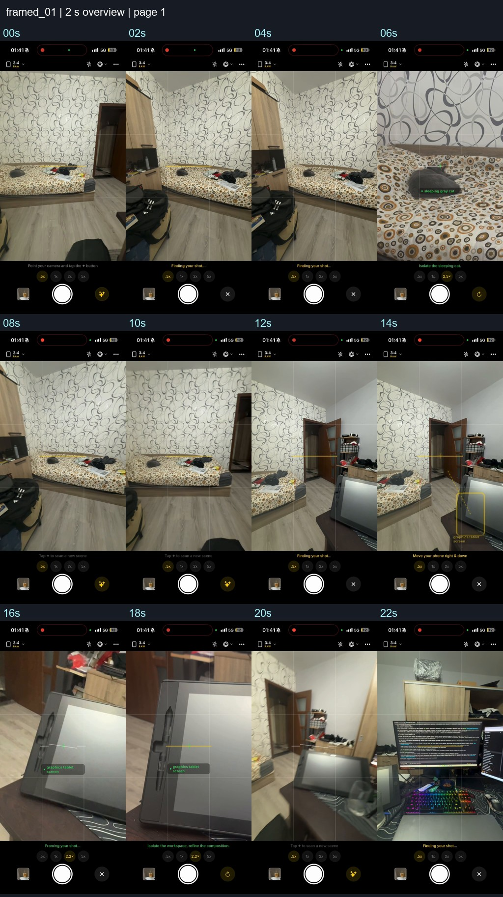
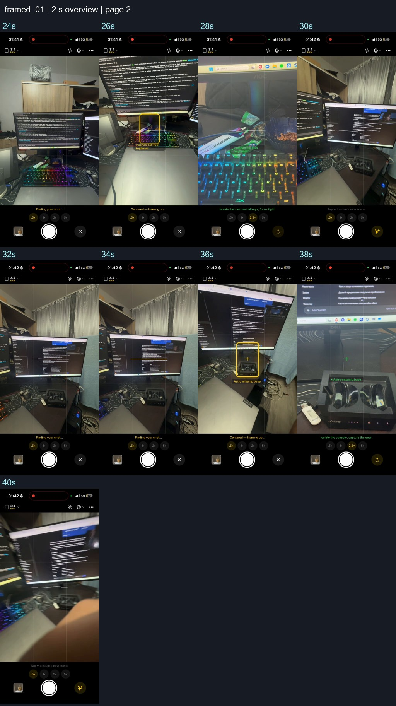
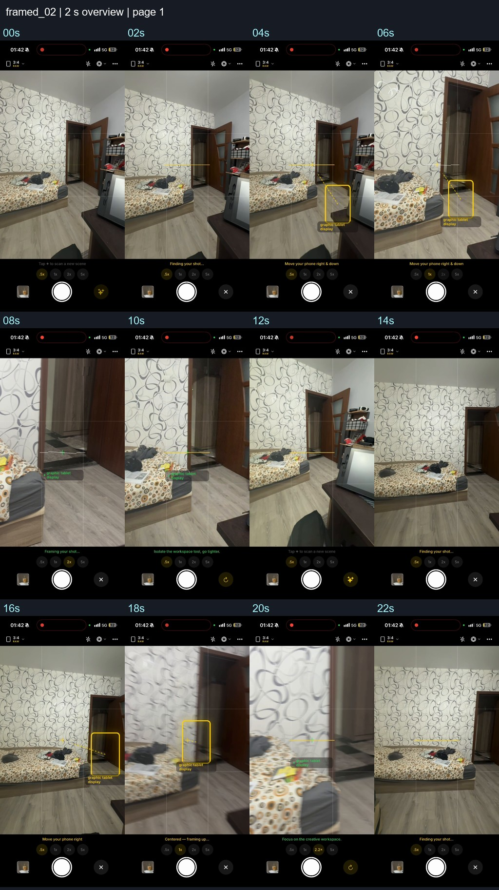
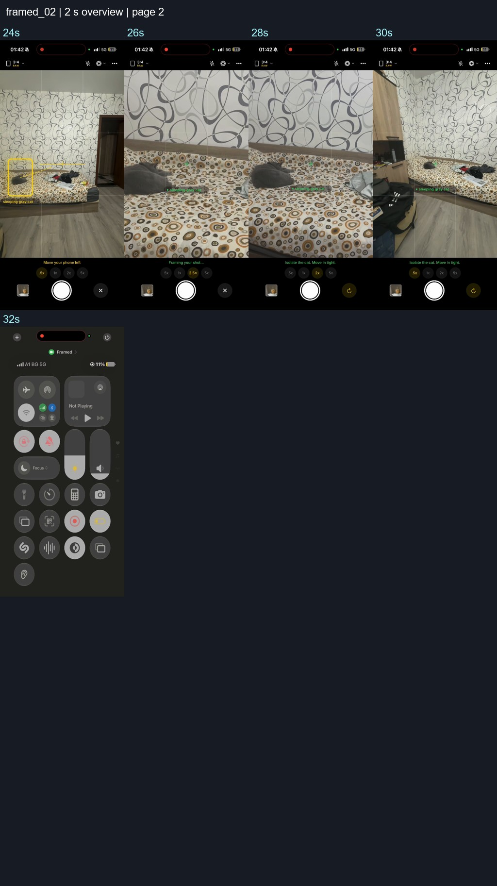
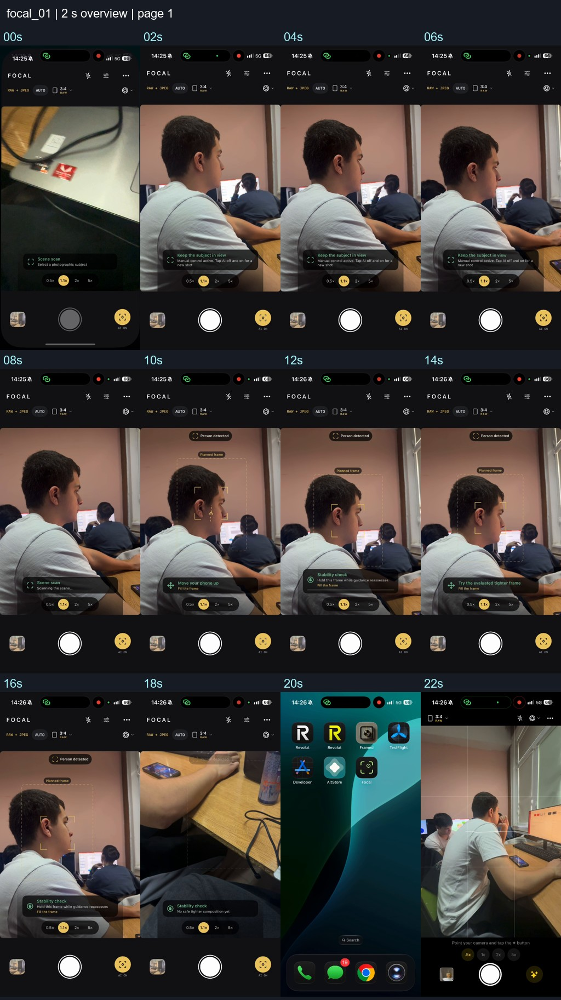
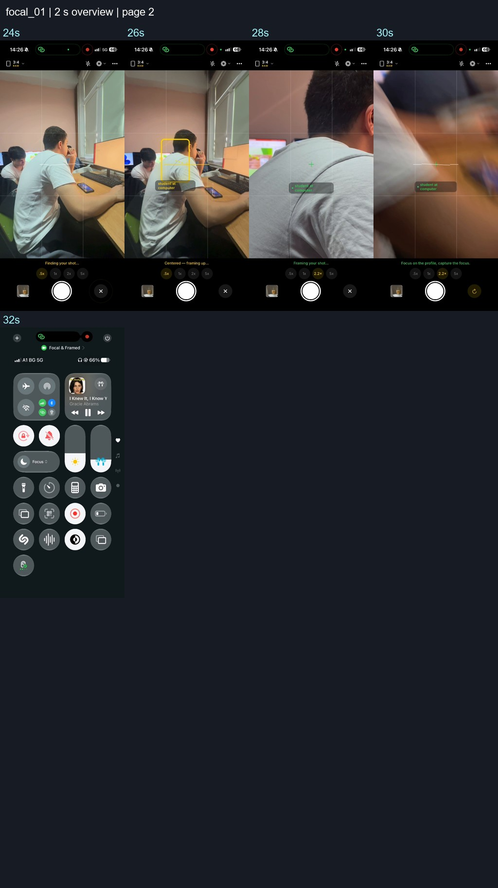
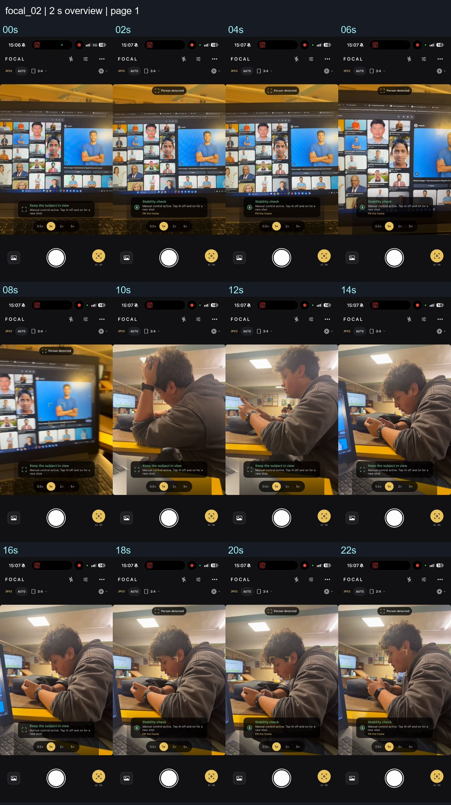
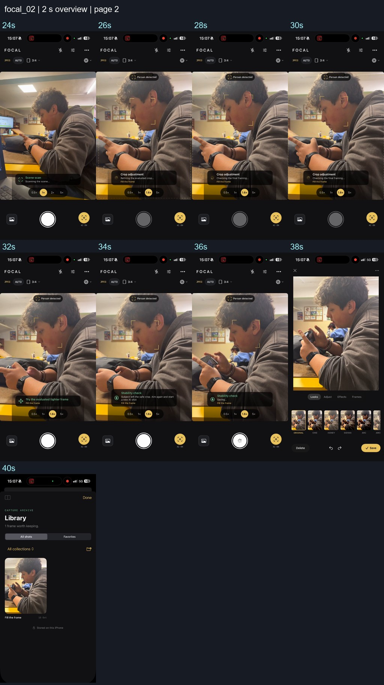

# Framed behavior analysis

Investigation date: 2026-10-16. Source audit is pinned to upstream `61081f524fb6e10d66bfb24d0e8c30953a4a9b4f` (2.11.1). All 205 fetched files were verified against Git blob SHA-1; reconstructed Git tree exactly equals upstream `d1cd425f63a9c6dd837e3af364acc1afebad0aa3`. The local checkout has a synthetic snapshot commit because shell cloning is blocked by its proxy; remote changes must use the actual upstream commit as parent. No claim is made that the old recordings run this source.

Evidence consists of four supplied 512×1112 H.264 MP4s. No IPA, device trace, build identifiers, separate screenshots, touch overlay, outdoor footage or matched final photographs were supplied. File identities and durations are in [the manifest](evidence/framed-comparison/manifest.json). FFmpeg 8.0.1 from existing Krita installation decoded at 1 fps; overview images show every other sample. Labels are approximate output time bins (nearest decoded source frame); they are not exact transition or inference timestamps. Selected historical status transitions were also inspected at 4 fps. Audio was not transcribed. No tools were installed.

## REA applicability

REA `binary_session(expected_package_version:"6.5.0")` succeeded with alignment `aligned`, 207 advertised MCP tools, and no active target. Ghidra and IDA are unconfigured; Hopper and Apple native helpers report unsupported Windows host. No unsupported Mach-O analysis was attempted. The supplied MP4s and Swift source do not have an applicable REA video/Swift-source analysis operation; video extraction and source audit use ordinary tools. No fabricated REA Evidence ID is assigned to manual visual observations. Previous session objdump probe failed with `ERR_REA_WINDOWS_NATIVE`; this investigation did not repeat it or repair configuration.

# Framed visual evidence review

Reviewed 2026-10-16. This report concerns only user-supplied Framed recordings. No Framed executable, IPA, source, model, runtime logs, touch stream, or sensor telemetry was available. No proprietary implementation was inspected. These findings are visual observations and bounded behavioral hypotheses, not algorithm recovery.

## Sources and timing

| ID | Original user-supplied file | Duration | SHA-256 |
|---|---|---:|---|
| framed_01 | `C:\Users\foxbg\Downloads\FocalAnalysis\Framed\ScreenRecording_10-16-2026 01-41-30_1.mp4` | 42.233 s | `28a63d98d4c881d614d53b93bb02074068591cfbdea44e4bff10d97b7390fff1` |
| framed_02 | `C:\Users\foxbg\Downloads\FocalAnalysis\Framed\ScreenRecording_10-16-2026 01-42-19_1.mp4` | 32.953 s | `af590b2fd7dd35f7199bab77bdf1de8a6fe08705e5bdcb5c9c4e2180b0a7a622` |

Both are 512 x 1112 portrait H.264 recordings at about 30 fps, with AAC audio streams. Audio was not listened to in this review. Original paths and probe metadata were read from `evidence/manifest.json`; existing overview sheets and selected full-resolution PNGs were visually inspected.

Timeline times below identify the existing `tNNN.png` one-second sample labels, not frame-accurate transition times. Extraction used `fps=1:start_time=0`; nearest source frame selection/rounding can shift a sample relative to a requested whole second. Do not interpret adjacent sample differences as exact processing latency. A 2-second overview is useful for navigation but cannot establish the absence of brief intermediate states. No touch visualization is present, so the origin of every zoom or reset is not provable.

The evidence depicts one indoor room: bed, sleeping cat, doorway, wardrobe, computer displays, graphics tablet, keyboard and a small Astro-branded desktop device. It contains no outdoor/forest scene, multiple people, competing animals, moving human subject, reflection test or controlled subject occlusion test.

## Directly observed timeline: framed_01

| Approx. playback time | Visible state / text | Zoom and scene | Evidence sample |
|---|---|---|---|
| 00–01 s | Idle; `Point your camera and tap the ✦ button`; gold sparkle control | .5x selected; room and cat on bed | t000, t001 |
| 02–04 s | Yellow `Finding your shot...`; right action control becomes X | .5x; wide bed/room | overview_01 |
| 05 s | Green subject label `sleeping gray cat`; `Framing your shot...`; center cross/level overlay | Still .5x; cat visible in wide scene | t005 |
| 06 s | Green `Isolate the sleeping cat.`; green subject label; circular retry control replaces X | 2.5x displayed; cat fills substantially more of preview | t006 |
| 07–10 s | Subject label disappears; `Tap ✦ to scan a new scene`; sparkle control returns | .5x displayed by 07 s while preview is initially still close; later wide bed | t007, overview_01 |
| 12–13 s | `Finding your shot...`, X control | .5x; camera turned to doorway and graphics tablet | t012–t013 |
| 14 s | Yellow rounded subject marker and `graphics tablet screen`; dotted yellow vector from center area; `Move your phone right & down` | .5x; tablet at lower right | t014 |
| 15 s | Marker near center; `Centered — framing up...` | .5x; camera moves down/right | t015 |
| 16 s | Green subject label; `Framing your shot...` | 2.2x; close view of graphics tablet | t016 |
| 17–19 s | Green `Isolate the workspace, refine the composition.`; circular retry control | 2.2x; tablet stays visible; label persists | t017–t019 |
| 20 s | Idle rescan prompt and sparkle control | .5x; wide room, camera turns toward desk | overview_01 |
| 22–24 s | `Finding your shot...`, X control | .5x; wide computer workspace | overview_01–02 |
| 25 s | Yellow marker labeled `mechanical RGB keyboard`; `Move your phone down` | .5x; keyboard below center | t025 |
| 26 s | `Centered — framing up...` | .5x; camera tilted down | t026 |
| 27–28 s | Green label; final green `Isolate the mechanical keys, focus tight.`; circular retry control | 2.5x; close crop includes keyboard and desk clutter | t027–t028 |
| 30 s | Idle rescan prompt | .5x; wide view aimed at other display | overview_02 |
| 32–34 s | `Finding your shot...` | .5x; display and desktop device | overview_02 |
| 35 s | Yellow marker `Astro mixamp base`; `Move your phone down` | .5x; device under monitor | t035 |
| 36 s | `Centered — framing up...` | .5x; device near center | t036 |
| 37 s | Green label and `Framing your shot...` | 2.2x close view | t037 |
| 38–39 s | Green `Isolate the console, capture the gear.`; circular retry control | 2.2x; same device remains visible | t038–t039 |
| 40 s | Idle rescan prompt | .5x; substantial camera motion | overview_02 |

No literal `READY` message is visible in these reviewed states. The word READY on the computer monitor at 37–39 s belongs to the web page being filmed, not Framed's UI. Green framing/final text and circular retry constitute an observable completion-like state; they do not establish an internal state named READY or a validated sharpness/composition threshold.

Each completed sampled sequence is short and bounded: first search visible around 02 s and final around 06 s; tablet search around 12 s and final around 17 s; keyboard search around 22 s and final around 27 s; desktop-device search around 32 s and final around 38 s. These are roughly 4–6 seconds of visible progression, including user camera movement, scene analysis and zoom. They are not measurements of inference duration.

## Directly observed timeline: framed_02

| Approx. playback time | Visible state / text | Zoom and scene | Evidence sample |
|---|---|---|---|
| 00 s | Idle rescan prompt | .5x; graphics tablet at right, bed left | overview_01 |
| 02 s | `Finding your shot...`; X control | .5x | overview_01 |
| 04–05 s | Yellow `graphic tablet display`; `Move your phone right & down`; yellow box/vector | .5x. Box is over floor/desk edge left of the visible tablet, rather than around the tablet display | t004–t005 |
| 06 s | Same yellow marker/instruction | 1x selected; tablet mostly outside/right of preview; box on doorway/floor | t006 |
| 07 s | Same instruction and label | 2x selected; box over doorway threshold/floor; tablet absent | t007 |
| 08 s | Green `graphic tablet display`; `Framing your shot...` | 2x; preview shows doorway/floor, no tablet | t008 |
| 09 s | Green `Isolate the workspace tool, go tighter.` and circular retry | 2.5x; doorway/floor, no tablet | t009 |
| 10–11 s | Same green final phrase and label persist despite view changing | .5x selected; bed/door at 10 s, tablet reappears at right by 11 s, label remains near screen center | t010–t011 |
| 12 s | Idle rescan prompt | .5x; wide scene | overview_01 |
| 14 s | `Finding your shot...` | .5x; bed/door | overview_01 |
| 15 s | `Centered — framing up...` without subject marker in this sample | .5x | t015 |
| 16 s | Yellow `graphic tablet display`; `Move your phone right` | .5x; yellow box over doorway, actual tablet absent | t016 |
| 17 s | Same instruction and label | 1x; box over wall/door edge next to bed | t017 |
| 18 s | `Centered — framing up...` and same label | 1x; marker still over door/wall edge | t018 |
| 19 s | Green label; `Framing your shot...` | 2.2x; doorway/floor, no tablet | t019 |
| 20 s | Green `Focus on the creative workspace.` and retry control | 2.2x; camera moving, preview remains bed/door | t020 |
| 21 s | Idle rescan prompt | .5x | t021 |
| 22–23 s | `Finding your shot...` | .5x; bed with cat | t022–t023 |
| 24 s | Yellow marker `sleeping gray cat`; `Move your phone left` | .5x; marker includes visible cat at left | t024 |
| 25 s | `Centered — framing up...` | .5x; camera panned toward cat | t025 |
| 26 s | Green label; `Framing your shot...` | 2.5x; cat near left edge | t026 |
| 27 s | Green final `Isolate the cat. Move in tight.` and retry control | 5x; much of cat cropped off at left | t027 |
| 28 s | Same final phrase/label, no return to Finding | 2x; cat visible | t028 |
| 29 s | Same final phrase/label | 1x | t029 |
| 30 s | Same final phrase/label | .5x; wide scene | t030 |
| 31 s | Same final phrase/label | 5x; cat close and partially outside left edge | t031 |
| 32 s | iOS Control Center replaces app preview | Recording termination interaction | overview_02 |

The 5x → 2x → 1x → .5x → 5x changes at roughly 27–31 s are consistent with preset zoom experimentation. Framed keeps the green final label/text and retry control through those sampled changes; there is no sampled return to Finding or automatic session termination. Because no touches/telemetry are recorded, the cause of each zoom step and zoom ownership cannot be conclusively identified from pixels alone. Earlier .5x → 1x → 2x changes at 05–07 s likewise coexist with active yellow guidance.

The label/marker mismatch in both tablet attempts is direct evidence that Framed's displayed guidance can refer to a named object that is not at the displayed marker or is absent from the current preview. It is NOT direct evidence of which internal component failed: initial localization, coordinate conversion, stale analysis, semantic misidentification, tracking drift, or intentional fixed target placement remain alternatives. The green final state does not prove ongoing object verification. Avoid describing Framed as a verified model of robust tracking, recovery or readiness.

## Finding ledger by requested behavior

| Question | Classification and supported finding | Engineering requirement for an independent implementation | Boundary / unknown |
|---|---|---|---|
| Automatic subject detection | **Directly observed:** semantic labels appear after user-initiated searches: sleeping gray cat, graphics tablet screen/display, mechanical RGB keyboard, Astro mixamp base. | A subject/region proposal with uncertainty handling and coordinates synchronized to preview. | Detector type, semantic model, local/cloud processing and recognition accuracy unknown. Subject labels are not proof of correctly localized detections. |
| Subject prioritization | **Directly observed:** one named subject is displayed per completed attempt; cat or objects can be selected depending on camera view. | Rank candidates and retain a selected candidate while usable. | No simultaneous competitive subject test; no person-versus-animal priority can be inferred. |
| Subject tracking | **Directly observed:** label persists as view moves; tablet marker can be over floor/wall when the named object is absent. **Strongly inferred:** label persistence alone is not ongoing semantic confirmation. | Revalidate identity/region and downgrade or recover after evidence loss; prevent stale semantic confidence. | Real tracker, fixed marker behavior and retained analysis strategy unknown. |
| Composition selection | **Directly observed:** all completed examples emphasize isolation/tight framing and move target toward center before close zoom. | Keep selection stable and make alternative compositions deliberate. | No proof of thirds, golden ratio, saliency ranking, leading lines or aesthetic optimizer. Centered examples do not show entire composition system. |
| Arrows / instructions | **Directly observed:** yellow box and dotted vector toward center, short directions `right & down`, `down`, `right`, `left`; then `Centered — framing up...`. | Direction from consistent preview coordinates, deadband near target, stable axis choice. | Numeric thresholds and whether marker means detector bounds or planned target region unknown. It is not a segmentation contour. |
| Zoom | **Directly observed:** searches begin .5x; close framing commonly 2.2x/2.5x, with final zoom changes in second clip preserving final UI. | Zoom coordination and a user-owned zoom grace period. | Exact automatic/manual ownership not proven; no zoom gesture telemetry. |
| Framing targets | **Directly observed:** subject markers move toward center/crosshair; examples use a 3x3 grid and level-style horizontal line. | A concrete target region tied to chosen composition and correct crop conversion. | Grid overlay does not prove rule-of-thirds selection. |
| Stability assessment | **Directly observed:** no repeated stability-check text is shown in reviewed samples; green completion can happen during camera motion or after incorrect localization. | Readiness that tolerates ordinary hand motion but checks relevant visual evidence. | IMU use, dwell, blur and stability thresholds unknown. No controlled still-versus-shake test. |
| READY | **Directly observed:** no literal READY UI; green final phrase plus retry control is reached repeatedly. | Expose reachable, meaningful manual-shutter readiness distinct from candidate existence. | Internal success criteria and exact state machine unknown. No automatic photo capture observed; absence of capture in these clips is not a universal behavioral guarantee. |
| Recovery after motion | **Directly observed:** final green phrases persist during camera/zoom changes; some sequences later reset to idle rescan prompt. | Maintain useful guidance or recover without endless loops. | User action versus automatic reset not established; touch-free clip cannot prove automatic recovery. |
| Recovery after loss | **Directly observed:** named tablet can stay accepted after actual object disappears. | Freshness checks, bounded lost-subject retention and reacquisition. | No clean controlled disappearance/reappearance test; exact recovery policy unknown. |
| Manual zoom | **Directly observed:** zoom preset changes coexist with retained active/final UI. **Strongly inferred:** visible zoom experimentation does not immediately dismiss guidance in these examples. | User zoom must not cancel AI Guide; recompute geometry at the chosen zoom and suppress zoom conflict. | Exact gesture events absent; cannot promise all manual zoom paths behave identically. |
| Multiple subjects | **Unknown:** room has many objects, but no controlled two-candidate comparison or two people/animals. | Candidate hysteresis, explicit selection where needed. | Cannot infer priority policy from a cluttered room alone. |
| Landscape / forest | **Unknown:** no such evidence supplied. | Independently derive geometry/color structure and accept scene compositions without person/animal. | No basis for attributing forest understanding to Framed. |
| Guidance latency | **Directly observed:** sampled search-to-final progression is generally about 4–7 s including camera movement; search-to-first direction/label around 2–3 s in several attempts. | Fast tracking loop decoupled from slower composition planning, stale result rejection. | This is UI-level elapsed progression, not inference latency or performance benchmark. |
| Visual feedback consistency | **Directly observed:** yellow active acquisition/centering → green framing/final, X → retry; short final phrases remain stable over seconds. Also observed: erroneous retained tablet labels and cat clipped during zoom. | Stable wording and clear confidence/recovery indicators; never equate color with verified correctness. | No haptics, accessibility, accessibility labels, background lifecycle or photo-result validation. |

## Strongly inferred, hypothetical and unknown

**Strongly inferred:** Framed exposes a user-triggered, bounded framing attempt with an analysis phase, a direction/centering phase, a tighter-view phase and a completion-like phase. It can operate on inanimate subjects. Stable final text and zoom continuity are useful observable interaction properties. They do not establish internal tracking or composition quality.

**Hypothetical:** semantic labeling might be produced separately from higher-frequency screen-coordinate guidance; persistent incorrect labels could follow an initial bad box or stale object hypothesis. These are possible explanations only. No available evidence distinguishes a learned detector from an image-language model, local from remote inference, a tracker from a fixed proposal, or planned crop from device zoom.

**Unknown:** proprietary algorithms, model weights, prompt content, server APIs, confidence scores, precise timers/deadbands, focus/exposure coupling, focus success, subject recovery policy, forest composition ability, alternate composition selection, power/thermal behavior and physical shutter implementation.

## Suggested screenshots / comparison panels

Use the original full frames, labeled with recording ID, approximate playback timestamp and sampling caveat. Do not label a Framed green final screenshot `READY`.

1. `framed_01/t014.png`: yellow tablet marker/vector + `Move your phone right & down`; demonstrates concise action plus spatial target.
2. `framed_01/t015.png`, `t016.png`, `t017.png`: centering → green framing → green completion-like phrase; demonstrates short bounded transition without asserting internal algorithm.
3. `framed_01/t025.png` and `t027.png`: keyboard is selected, camera moves down, tighter final crop; inanimate subject support.
4. `framed_02/t004.png` and `t009.png`: marker on floor, later accepted doorway despite tablet absence; documents a limitation of Framed rather than presenting it as ground truth.
5. `framed_02/t024.png`, `t027.png`, `t030.png`, `t031.png`: cat acquisition and retained final UI across .5x/5x changes, including clipped cat; useful for zoom-continuity comparison and avoiding claims of framing perfection.
6. `framed_01/t038.png`: named desktop object and stable final phrase; identify monitor content as background scene, not app UI.

Suggested annotation overlays: outline Framed's instruction/zoom/control areas and add a short external caption. Avoid drawing a supposed model bounding box where only a UI marker exists. Keep originals available to audit the annotation.

## New recording tests needed

1. Enable a separate visible touch indicator or film phone/hands externally; start guidance, pinch and tap every zoom preset during search/guidance/final phases. Establish which zoom changes are user-owned and whether automatic zoom fights them.
2. Place one stationary subject, accept it, pan away until absent for 1/3/8 seconds, then return. Do not touch rescan/cancel. Record whether marker confidence changes, guidance recovers or stale success persists.
3. Film two known subjects separately and together, cross their positions and temporarily obscure the selected one. This tests priority and identity retention independently of UI persistence.
4. Repeat on tripod, normal handheld, slow pan and brief shake. Measure UI transitions from exact frames while recording user action time. Separate time to first direction from time to final state.
5. Use matched autumn forest scenes: path/vanishing point; repeated trunks; a symmetric pair; branch opening/natural frame; near leaf/mushroom; stream/reflection; fog/backlight. Include a scene without people or animals. Record the actual image and selected subject/region, not just the instruction.
6. Take manual-shutter output photos for matched settled compositions. A pleasing preview or green state alone does not prove final framing, focus or exposure quality.

REA's Windows binary tools are not applicable to video pixels. This review uses passive user-supplied runtime recordings and ordinary image inspection; REA connectivity/provider verification belongs in the main investigation report. No binary provider or proprietary artifacts were needed here.

## Visual timelines for every supplied recording

### framed_01 (42.23 s)

### framed_02 (32.95 s)

### focal_01 (32.70 s)

### focal_02 (42.40 s)

